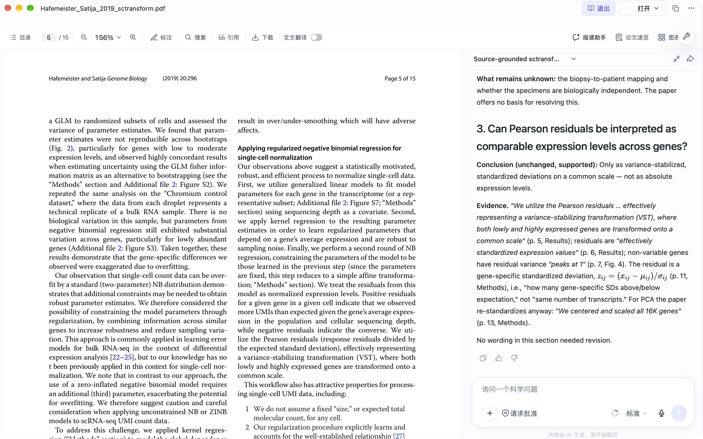

# Correct quotations, overbroad claims: a paper-reading case

**Release v1.2.**

**Reading problem.** A methods paper usually states *where its method applies* in a few scattered sentences:
the abstract, the model definition, related work. When an AI assistant answers "does this paper support
using the method on my data?", it can quote those sentences exactly and still summarize the scope wrongly
with words such as *only*, *never* or *nothing*. Checking that every quote is on its page does not catch this.

**Case.** One real session in the Bohrium Science Space desktop App (玻尔·科学空间, reading assistant) on the
2019 sctransform paper. Thirteen selected quotations were all on their stated pages, yet two scope statements
were too broad. An independent source check found the counter-passages, a page-specific follow-up supplied
them, and the App revised both statements. The App's own working panel shows why one of them happened.

**What you can reuse.** A claim-scope audit workflow with prompt templates ([WORKFLOW.md](WORKFLOW.md)) and
two small scripts that check quote pages and absence claims against any PDF.

One paper, the original two-round reader session and one later valid T1-R development probe. An earlier uncertain input event is retained but excluded. This is not an official score or a randomized benchmark.

## How to read this repository

Three kinds of text appear, and they are kept apart:

| Label used below | Meaning | Where it lives |
|---|---|---|
| **Paper** (p. N) | Wording from the publisher PDF, with its physical page | [materials/](materials/Hafemeister_Satija_2019_sctransform.pdf) |
| **App** | What the reading assistant displayed, unchanged in wording | [app-answer.md](app-answer.md), [app-followup-answer.md](app-followup-answer.md), raw `*-ax.txt` exports |
| **Our check** | Our source check, inference or judgement | [verification.md](verification.md), `*.tsv`, `*-check.json`, script outputs |

[M] marks something measured or observed in a file here; [I] marks our inference.

| Step | Evidence |
|---|---|
| Paper | [Publisher PDF](materials/Hafemeister_Satija_2019_sctransform.pdf), 15 pages, CC BY 4.0; rights in [SOURCE.md](SOURCE.md) |
| Round 1 | [prompt.txt](prompt.txt) -> [app-answer.md](app-answer.md); raw [app-answer-complete-ax.txt](app-answer-complete-ax.txt); [export-provenance.json](export-provenance.json) |
| App working panel (round 1, mid-answer) | [app-inprogress-ax.txt](app-inprogress-ax.txt); [inprogress-export-provenance.json](inprogress-export-provenance.json) |
| Source check | [source-answer-review.tsv](source-answer-review.tsv), [verification.md](verification.md), [quote-page-check.json](quote-page-check.json) |
| Round 2 | [followup-prompt.txt](followup-prompt.txt) -> [app-followup-answer.md](app-followup-answer.md); raw [app-followup-complete-ax.txt](app-followup-complete-ax.txt); [followup-export-provenance.json](followup-export-provenance.json) |
| Revision | [revision-comparison.tsv](revision-comparison.tsv), [followup-quote-page-check.json](followup-quote-page-check.json) |
| Re-runnable checks | [reproduce_quote_pages.py](reproduce_quote_pages.py) -> [output](reproduce-quote-pages-output.json); [replay_absence_search.py](replay_absence_search.py) -> [output](replay-absence-search-output.json) |
| Screenshots | [02](02-reading-request.jpg), [03](03-method-page.jpg), [04](04-followup.jpg) (described under "Repeat the App session") |

AX = the accessibility text of the actual App window, exported during the session. It is what was visible on
screen, not native model telemetry. The Markdown answers remove UI wrappers and duplicate headings and rejoin
equation glyphs; wording and errors are kept. The first answer was never overwritten.

## The question and why this method

**Constructed scenario** (no real patients): six tumour biopsies measured with 10x UMI counts plus a separate
Smart-seq2 TPM matrix. Three questions: does the paper support sctransform on both inputs; do six biopsies
establish six independent patients; can Pearson residuals be read as comparable expression levels across genes?

Each question is a scope decision whose evidence is spread across the paper (pp. 1, 2, 3, 5, 6, 7, 8, 9, 10, 11, 13, 14).
Design choices and the trade-off behind each:

| Choice | Why | Cost / limit |
|---|---|---|
| Ask inside the App's reading assistant with the PDF open | The assistant reads the paper itself (parsed into blocks, see next section) and cites pages, so every claim is tied to a location we can open. | We see only what the UI shows; model, version and tokens are not visible. |
| Force a three-way split: paper states / follows from scenario / unknown | Keeps "the paper says UMI" apart from our inference "so TPM is out of scope" and from what nobody can know (the biopsy-to-patient mapping). | Longer answers. |
| One short exact quote + page per claim | Makes a mechanical check possible: a quote is on its page or it is not. | Proves location only, not that the surrounding sentence is right. |
| Separate scope review of absence / uniqueness words | Those words are claims about the whole paper; no single quote can support them. | Needs a human reading and a synonym list. |
| Correct with a follow-up in the same session, not a fresh run | Keeps the original answer as evidence and tests whether the assistant can revise against page evidence. | It is assisted revision, not self-correction. |

## How the reading assistant handled the PDF (observed)

A snapshot of the App window taken while the first answer was still being generated
([app-inprogress-ax.txt](app-inprogress-ax.txt), captured 02:25:48 UTC+8) shows the assistant's working panel [M]:

| AX node | What the App showed | What it tells a user |
|---|---|---|
| 23-27 | Step summaries: inspect the PDF structure, read the rest, "run targeted searches", "confirm with exact-case searches". | The assistant works in tool steps over the paper, not from memory of it. |
| 28 | `查看 Hafemeister_Satija_2019_sctransform.jsonl` | It reads a parsed block file of the PDF; the final answer says "197 blocks, pages 1–14". |
| 29 | `搜索内容 Smart\|TPM\|transcripts\|biops\|patient\|Donor\|donor\|full-length\|full length，共 1 处` | Searches are regular expressions over the parsed text; the panel shows the pattern and the hit count. |
| 31 | "Only one match: \"Healthy Donor\" ... No Smart-seq2, no TPM, no biopsy, no patient." | The absence statements in the answer come from this kind of lexical search. |
| 32-77 | Draft notes listing each quote with a block `resourceId` (`pdf-block-…`), line and page. | Citations are anchored to parsed blocks, consistent with all 13 checked quotes being on their pages [I]. |
| 99 | Draft: "doesn't address patient/sample independence or replication design". | "Replication" enters the draft here; the visible search pattern above does not contain it. |
| 119-128 | "正在分析... 29.8s"; input bar with 请求批准 (approval mode), "上下文已使用 14%", 推理强度 (disabled), "内容由 AI 生成，请仔细甄别". | Context use is shown; the reasoning-strength control was disabled while generating (screenshots 02 and 03 show it set to 标准). |
| 143-146 | PDF toolbar: 全文翻译 off, **阅读助手 on**, 论文速览 off, 图表速览 off; page field "/ 15". | Only the reading assistant was used; summary, figure and translation features were not. |

After the answer finished, the App collapsed this panel behind "已处理（用时 1m 6s）". Earlier search steps
(nodes 24, 26) are collapsed summaries without patterns; they name Smart-seq2, TPM, non-UMI, biopsy and
patient, but not replicate or read-level. The block file itself is internal
and not available to us.

Practical tips from this record [I]:
- Expand the working panel while the answer is generated (or export it); it is the only place the search
  patterns behind an "X does not occur" statement are visible.
- The parsed block file covered pages 1–14 of 15; page 15 holds only references 22–39 and the publisher's note [M, from the extracted text],
  so nothing in the body was missed here, but check the stated page range on your own paper.
- Keep 阅读助手 as the only feature on when you want an answer grounded in the paper text alone, and say so in
  the prompt ("Use only this PDF").

## Results

| Question | Paper | App (round 1) | Our check |
|---|---|---|---|
| UMI and TPM inputs | "Our approach can be applied to any UMI-based scRNA-seq dataset" (p. 1); "We explicitly model the UMI counts…" (p. 11) | Supports the 10x UMI input, not the Smart-seq2 TPM input | Supported. TPM exclusion is an inference from the count-model input contract, not a TPM experiment in the paper. |
| Six biopsies = six patients? | No biopsy or patient text; the main-text dataset is PBMCs from one healthy donor (p. 14) | No; the mapping is unknown | Supported as scenario reasoning; the paper cannot supply the mapping. |
| Residuals comparable across genes? | "transformed onto a common scale" (p. 5); z = (x − μ)/σ (p. 11); PCA additionally "centered and scaled" (p. 13) | Only as standardized deviations, not absolute expression | Supported. Keep the p. 9 caveat on depth independence and read "peaks at 1" (p. 7) as a distribution, not a per-gene rule. |

All 13 selected round-1 quotes and 4 round-2 quotes are on their stated pages [M]; this is a location check,
not an accuracy percentage. Full review: [source-answer-review.tsv](source-answer-review.tsv), [verification.md](verification.md).

## Why the two statements were overbroad

| | App wording (round 1) | Paper | Our check |
|---|---|---|---|
| A2 | "Nothing about biopsies, patients, or replicate design — those terms do not occur." | "the data from each droplet represents a technical replicate of a bulk RNA sample" (p. 5) | Absence claim not covered by its search: "replicat" is absent from the visible pattern and present on p. 5. |
| A3 | "The only reference to non-UMI data is about a different tool … SCnorm" (p. 3) | "initial strategies focused on read-level (instead of UMI-level) data" (p. 2); "DESeq … for read count data" (p. 11) | Uniqueness claim true for the literal token, false for the concept: "non-UMI" occurs only on p. 3, its synonyms on pp. 2 and 11. |

[replay_absence_search.py](replay_absence_search.py) replays the App's visible pattern on our text
extraction and audits these claims ([actual output](replay-absence-search-output.json)) [M]:
- the visible pattern gives exactly one case-sensitive match, "Donor" on p. 14, consistent with the App's
  "共 1 处" (the App searched its own block file, so this is consistency, not identity);
- `biops`, `patient`, `Smart-seq`, `TPM`: no match on any page, so A1 ("Smart-seq2 and TPM never appear") holds for this PDF;
- `replicat`: not in the visible pattern, match on p. 5;
- `non-UMI`: p. 3 only; `read-level`: p. 2; `read count`: p. 11 (and the p. 15 reference list).

Interpretation [I]: both errors are lexical-search errors stated as whole-paper facts. A2 names a term the
visible search did not test, and no step summary names it (p. 5 contradicts the claim either way). A3 is a
synonym gap: "non-UMI" was searched (node 26), its synonyms were not named, and the search-style answer is right about the word and wrong about
the idea. Neither is a quotation or page error, which is why the quote check passed.

**Remedy that was tested** [M]: the page-specific follow-up ([followup-prompt.txt](followup-prompt.txt)). The
App quoted its earlier sentences, revised both, added the p. 11 DESeq passage on its own, and kept the three
conclusions ([revision-comparison.tsv](revision-comparison.tsv)). The counter-evidence came from our check, so
this shows the assistant can revise against page evidence, not that it finds the error unaided.

## T1-R observed once: improvement and remaining overreach

A fresh App task received the original question plus both T1-R sentences, with only whitespace normalized to a single line. [The pre-send field excerpt](t1r-test/before-send-excerpt.txt) contains the complete rule; [the sent text](t1r-test/sent-prompt-single-line.txt) records it. No page-specific counterexample was supplied.

The [working-panel excerpts](t1r-test/search-observations-excerpt.jsonl) show actual searches. The [captured final-answer excerpt](t1r-test/final-answer-excerpt.txt) reports terms and page hits:

| Observed behavior | Evidence and limit |
|---|---|
| The search includes `donor\|individual\|subject\|participant\|replicat`. | The App reports 7 group hits on pp. 2,4,5,9,14, including “technical replicate.” This is not seven occurrences of “replicate.” |
| It searches full-length / plate-based / non-UMI / read-level and related wording. | The App reports 5 group hits on pp. 2,3,11,15. Exact patterns are retained in the working-panel excerpts. |
| The visible answer lists search terms and hit pages, and no longer says replicate-related wording is absent. | The captured question-2 text keeps the biopsy-to-patient mapping unknown. Some other long nodes were clipped around 512 characters, so this is not a complete untruncated answer. |
| A uniqueness overreach remains. | The search table calls its five hits “the only non-UMI / read-level / plate-based mentions.” Matching a chosen pattern does not establish exhaustive conceptual coverage; p.8 also describes plate- and droplet-based protocols. |

The App displayed **2m 10s**. This is one non-randomized development observation, not evidence of stable or causal improvement. It used **a new desktop task with the PDF attached**, and the answer says it extracted text directly with `pdftotext`. The original two-round case used the paper reader's parsed-block route. The changed entry mode and extraction method prevent a matched prompt-effect comparison.

An earlier multiline-entry event appeared to submit before the planned Send action. Delivery of the appended rule was not established; [its captured excerpt](t1r-test/initial-entry-excerpt.txt) and [interface record](t1r-test/INTERFACE_EVENT.md) are retained and **not counted as a T1-R test**. [Provenance](t1r-test/PROVENANCE.json) declares privacy/UI omissions, local-path redaction and node truncation.

[The real safe screenshot](t1r-test/workspace-result.jpg) was captured after completion in the PDF workbench. Opening that view does not change the task's original execution mode. No account-bearing screenshot is included.


## Reusable workflow

[WORKFLOW.md](WORKFLOW.md) turns this case into an eight-step claim-scope audit with prompt templates T1
(used), T1-R (one development probe) and T2 (used), and explains how to point both scripts at another paper. In short:
ask with a three-way split and page quotes -> check quote pages mechanically -> list every absence/uniqueness
claim with its terms and synonyms -> search and open each hit -> follow up with page-specific evidence ->
keep a revision table -> re-check the new quotes.

When it works: claims stated in the extractable main text of the supplied PDF. When it does not: figures,
equations and tables as images; supplements not supplied; concepts expressed without any listed keyword.

## Repeat the App session

Environment: Bohrium Science Space desktop App (bundle `com.bohrium.scix`) on macOS 27.0, Apple silicon. The
installed App reads version 0.10.14 and its version file predates the session, so the session most likely
ran 0.10.14 [I]; the UI did not display a version, model or token count.

1. In the App open **文献阅读 → 本地导入** and select the included PDF.
2. Open the paper and switch on **阅读助手** (leave 论文速览, 图表速览, 全文翻译 off). The viewer shows 15 pages.
3. Send [prompt.txt](prompt.txt) unchanged. Expand the working panel while it runs; export or copy the
   complete answer before doing anything else.
4. Run the checks below. Open the counter-passages on pp. 2, 5 and 11.
5. Send [followup-prompt.txt](followup-prompt.txt) and save the second answer separately.

Screenshots (real, unedited, account name not visible): [02](02-reading-request.jpg) shows the original
request and the completed round-1 answer with the 1m 6s badge; [03](03-method-page.jpg) shows Methods p. 11
beside the session; [04](04-followup.jpg) shows the round-2 answer beside p. 5.



**What counts as the same result.** Answers are generated, so wording will differ. Treat the case as
reproduced if (a) the three conclusions match the Results table, (b) every quote you check is on its stated
page, and (c) you find, or do not find, absence/uniqueness statements that the audit contradicts. Record (c)
either way; a run without A2/A3 is a useful data point, not a failure.

## Repeat the source checks

Requirements: Python 3.10+ (we ran 3.12.2) and Poppler `pdftotext` (26.08.0) on PATH; no other packages,
no network, no model. [requirements.txt](requirements.txt) also records pypdf, used only for the text budget.

```sh
python3 reproduce_quote_pages.py  > my-quote-check.json
python3 replay_absence_search.py  > my-absence-check.json
```

Expected, as in the shipped outputs from our run on 2026-10-31: `"pages": 15`; all 17 records with
`"claimed_page_contains_quote": true`; replay shows one visible-pattern match (p. 14) and the page hits listed
above. A different Poppler version may change whitespace but should not change any page number; if one does,
open that page in the PDF before trusting either result. Matching removes whitespace and joins line-end
hyphens, so it validates text location only, not figures, equations or meaning.

## Measured facts and unknowns

- App badges: 1m 6s (round 1) and 33s (round 2) [M]. The badge's scope is undefined: the mid-answer snapshot
  already showed 正在处理…（用时 1m 7s） (node 21). They are not summed: the source check and follow-up
  writing took additional, untimed effort.
- The App reported reading 197 parsed blocks on pp. 1–14; the PDF has 15 pages, p. 15 being references and the publisher's note [M].
  Our searches covered all 15. No supplements were supplied.
- Model, version, token use and billed cost were not visible: **unavailable**, not zero.
- Not claimed: a controlled baseline, a comparison with other tools, scientific reproduction, human-expert
  approval, generality beyond this paper, or that T1-R has a stable or causal benefit.

## Sources and contribution

Paper: Hafemeister C, Satija R. *Normalization and variance stabilization of single-cell RNA-seq data using
regularized negative binomial regression*. Genome Biology 20, 296 (2019), DOI
[10.1186/s13059-019-1874-1](https://doi.org/10.1186/s13059-019-1874-1); © The Author(s) 2019, CC BY 4.0,
included unchanged ([SOURCE.md](SOURCE.md)).

Our work: the reading scenario and prompts, both real App rounds and their exports, page-by-page quote
checks, the scope review, the root-cause analysis from the App's working panel, the workflow and templates,
and both scripts. App answers and the working-panel text are the App's output, attributed as such.

## Changes in v1.2

Added a single real T1-R probe with complete entered input, selected working-panel/final-output evidence, declared clipping/privacy transforms, a safe screenshot and the invalid initial-entry record. Updated T1-R status and limitations without rewriting the original answers or check results. No new script run or public release is claimed.

## Changes in v1.1

Added: problem and design-rationale sections; the mid-answer working-panel export with provenance and its
analysis; the root-cause section and `replay_absence_search.py` with its real output; the real output of
`reproduce_quote_pages.py`; [WORKFLOW.md](WORKFLOW.md); environment, expected outputs and reproduction
criteria; the Paper / App / Our-check labelling. Unchanged: the PDF, prompts, App exports, screenshots, check records and review tables of v1.0;
only spacing typos in verification.md and one header line in app-answer.md were corrected. [TEXT_BUDGET.json](TEXT_BUDGET.json) re-measured.
[提交说明.md](提交说明.md) is the competition submission note.

## License

Text, prompts, check records and scripts written for this case: [CC BY-NC-ND 4.0](LICENSE). The paper PDF
keeps its own CC BY 4.0 license ([SOURCE.md](SOURCE.md)). App output and screenshots are reproduced as
observations of the Bohrium Science Space App; no ownership of the product interface is claimed.
